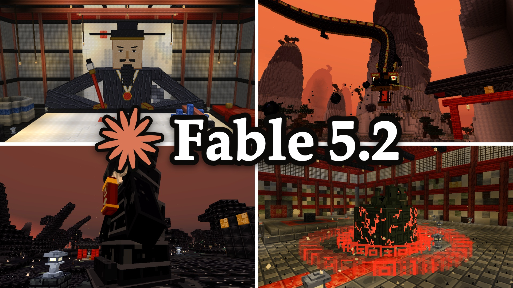
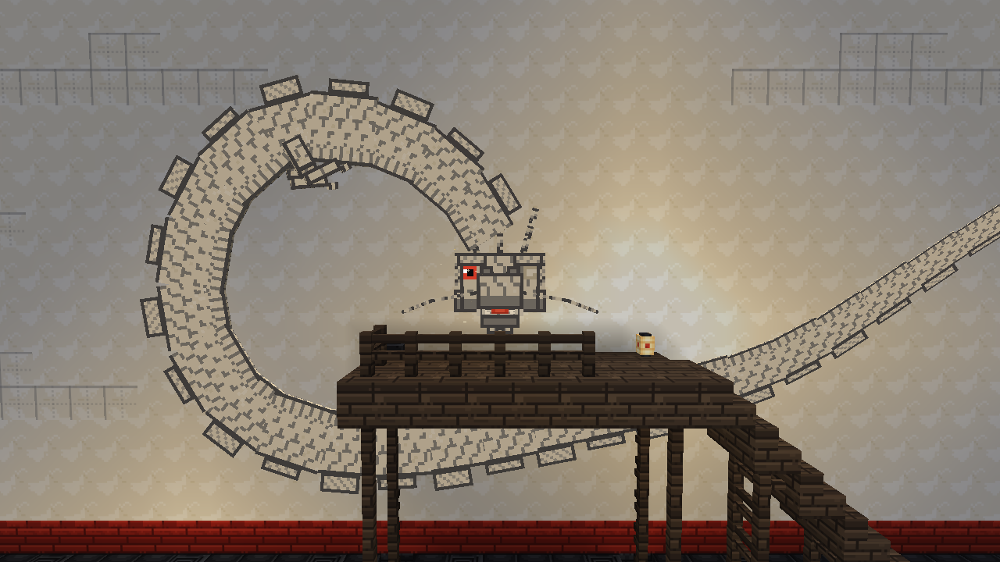
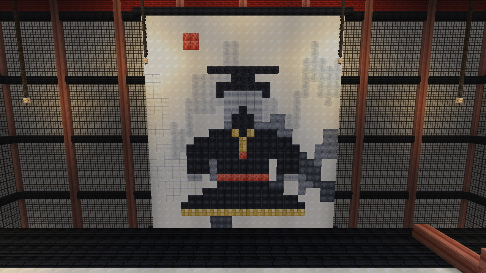
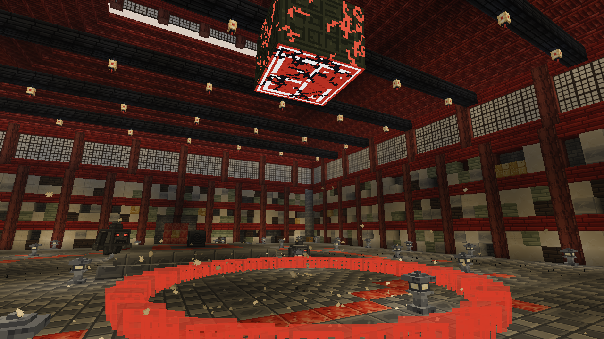
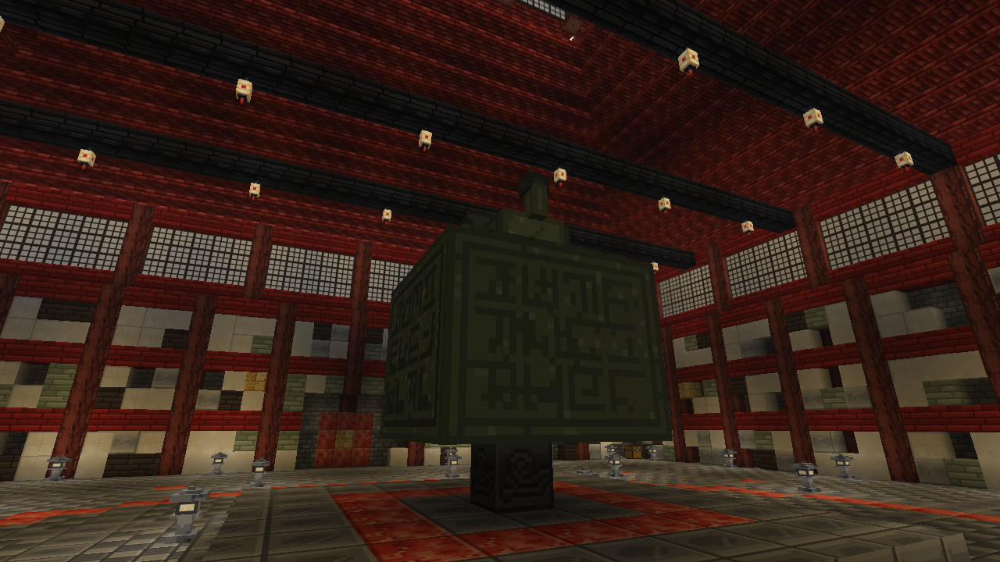

# Inkveil

**A realm inside an unfinished painting.** Step through a scroll into an ink-wash world of eight lands, new creatures, four bosses, and an unfinished story waiting for its last stroke.

## Download

**[Download the latest Inkveil release](../../releases/latest)**

The downloadable file is named `inkveil-1.0.0.jar`. GitHub's automatically generated **Source code** archives are not the mod and will not work in your `mods` folder.

## Requirements

- Minecraft **26.3**
- Fabric Loader **0.20.1 or newer**
- [Fabric API](https://modrinth.com/mod/fabric-api) **0.165.2 or newer**
- Java **25 or newer**
- Inkveil must be installed on the server and on every player's computer

## Installation

1. Install Fabric Loader and Fabric API for Minecraft 26.3.
2. Download `inkveil-1.0.0.jar` from the [latest release](../../releases/latest).
3. Put the JAR in your Minecraft `mods` folder.
4. For multiplayer, install the same JAR and Fabric API on the server and for every player.

## Enter the painting

Find a painter's hermitage in the Overworld. Inside is an unfinished scroll, a worn brush, and torn pages from the Master's notes. Mount the scroll, paint it with living ink, and step into the picture. Everything is also available from the Inkveil creative tab.

## What's inside

- A new ink-wash dimension: black karst peaks above a sea of mist under a red seal-sun
- Eight lands: Inkspire Peaks, Vermilion Grove, Malachite Terraces, Azurite Mere, Gilded Expanse, the Unpainted, the Blot, and the Ochre Hollows
- Paper cranes, ink koi, daublings, ink monkeys, gilt carp, inkwell snails, bristle boars, and more
- Blot lurkers, hollow scribes, paper tigers, shade puppets, seal golems, and fadewights
- Four main bosses: the Grand Seal, the Spill, the Unfinished Dragon, and the Likeness
- A rideable mist crane, brushes, lacquer and dragon-ink armour, tools, food, and an in-game field guide

## Gallery

| The Unfinished Dragon | The Likeness |
| --- | --- |
|  |  |

| The Grand Seal | The final stamp |
| --- | --- |
|  |  |

## License

Inkveil is distributed under an **All Rights Reserved** license. You may download and play the mod and run it on your own server. You may not re-upload or redistribute the JAR as your own work.

